# Post Pulse

A private performance dashboard for your LinkedIn analytics export. Import the `.xlsx` file LinkedIn gives you and see what's working, what's slowing down and what to change next.

**Your data never leaves your device.** Post Pulse is a static web app: no server, no account, no tracking. Everything is parsed and stored in your browser (IndexedDB). A Content Security Policy blocks requests to any other site, and an automated test checks it.

**Live example:** [lipulse.netlify.app](https://lipulse.netlify.app). Choose *Try with sample data* to look around without an export. The example is built separately and may lag behind `main`.

Not affiliated with LinkedIn Corporation.

> Status: Phase 1 (MVP, beta). See [docs/SPEC.md](docs/SPEC.md) for scope and behaviour.

## Screenshots
All screenshots use the built-in sample data: made-up posts, no real profile.

**Overview:** key numbers for the selected time window, sparklines and "What stands out".

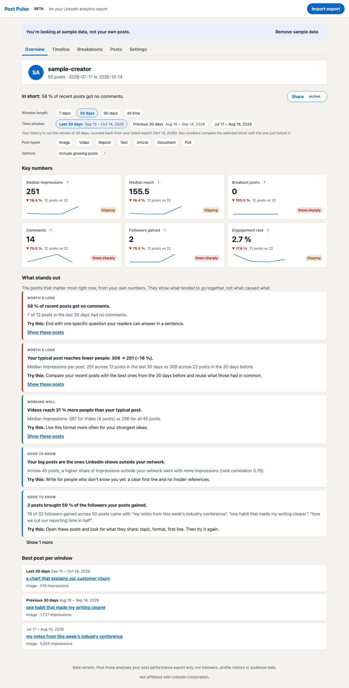

**Timeline:** every post as a dot, with the median of the last 7 posts.

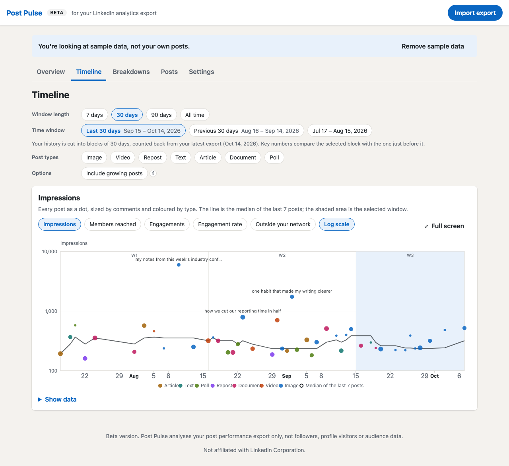

**Breakdowns:** formats, reach outside your network and posting rhythm.

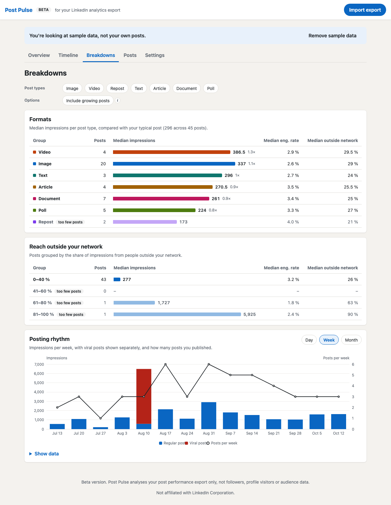

**Posts:** sortable and searchable table with CSV export.

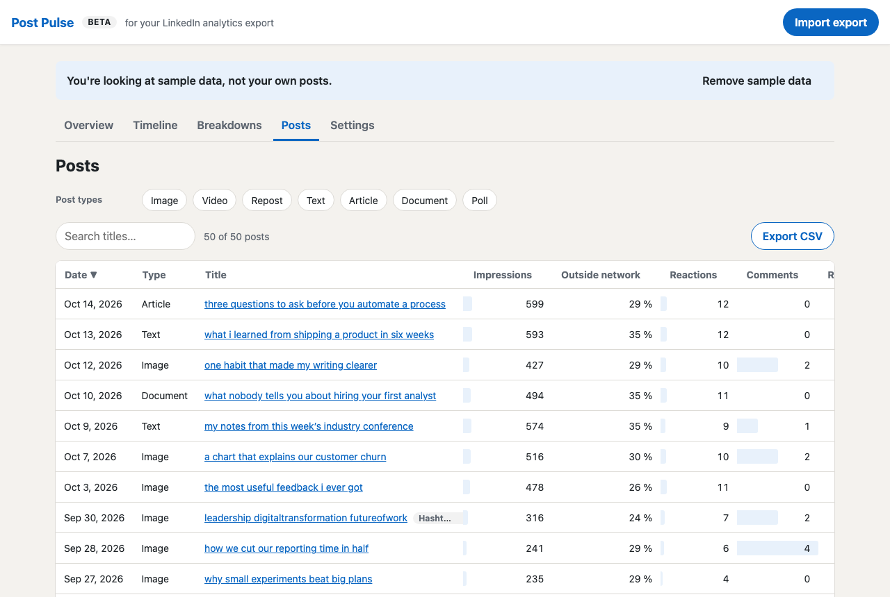

**Share carousel (Alpha):** slides drawn in your browser and saved as one PDF for a LinkedIn document post.

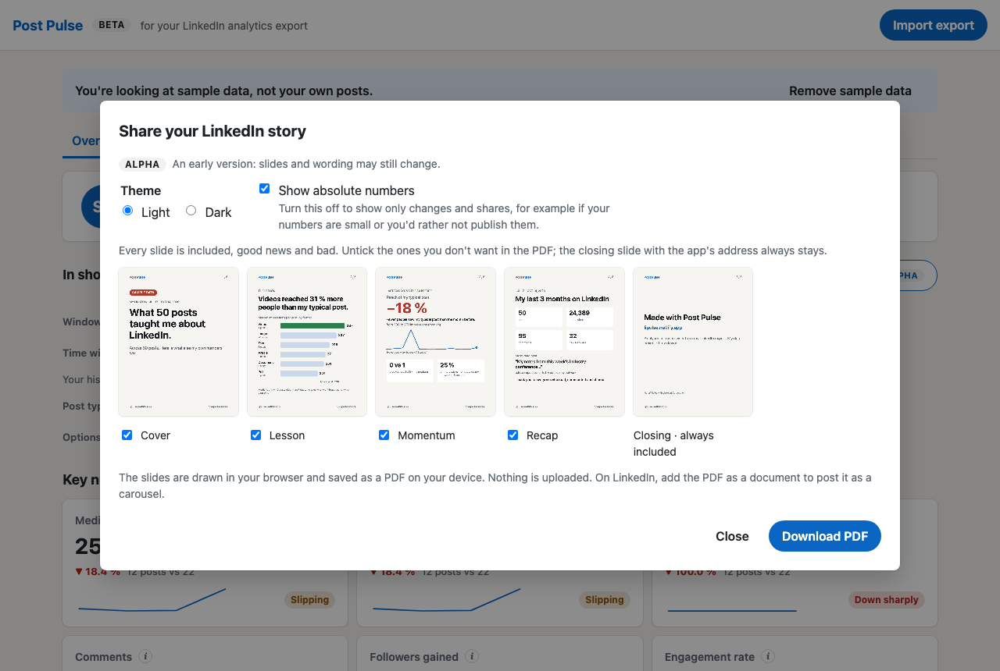

<p>
  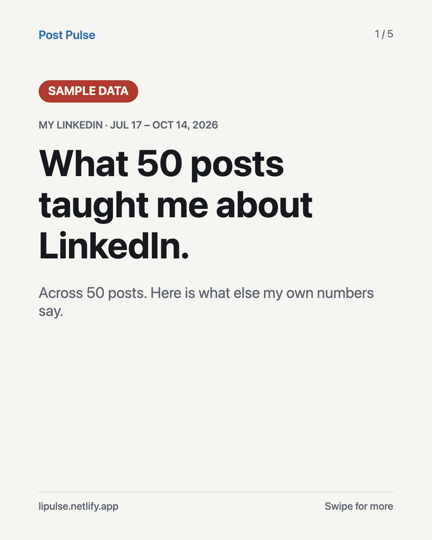
  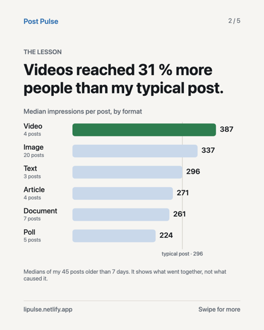
  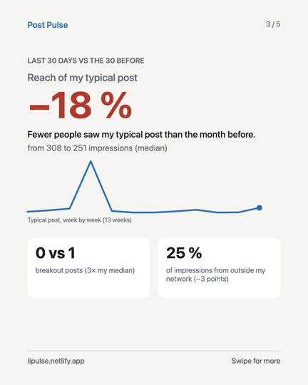
  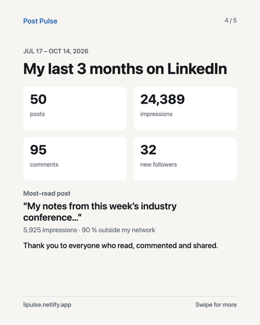
  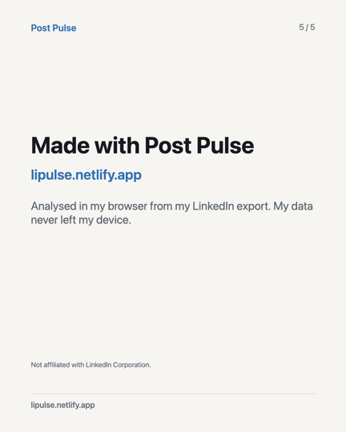
</p>

**Settings:** theme, breakout and viral thresholds, backup, restore and delete.

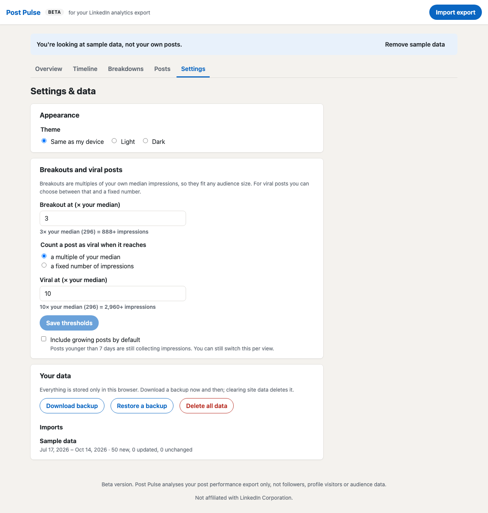

**Start screen and dark mode**

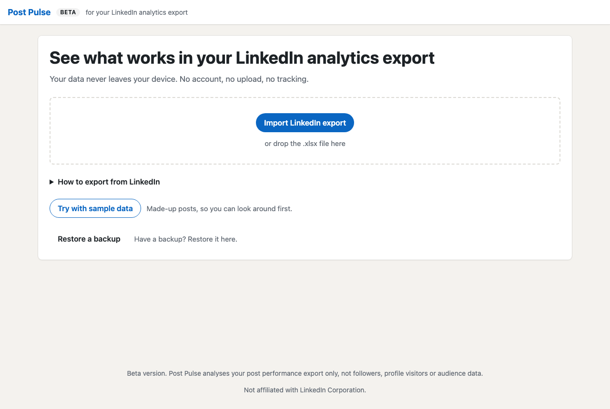 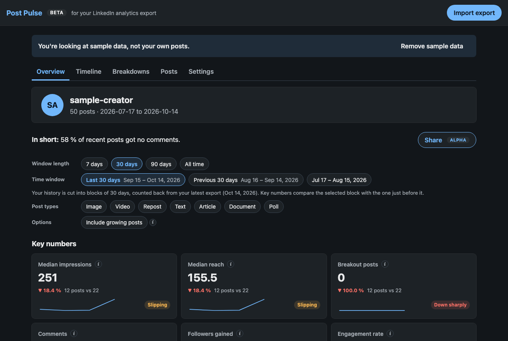

## Export your data from LinkedIn
Use LinkedIn in a web browser (the mobile app has no export).

1. On the home page, open your **Post impressions** stats.

   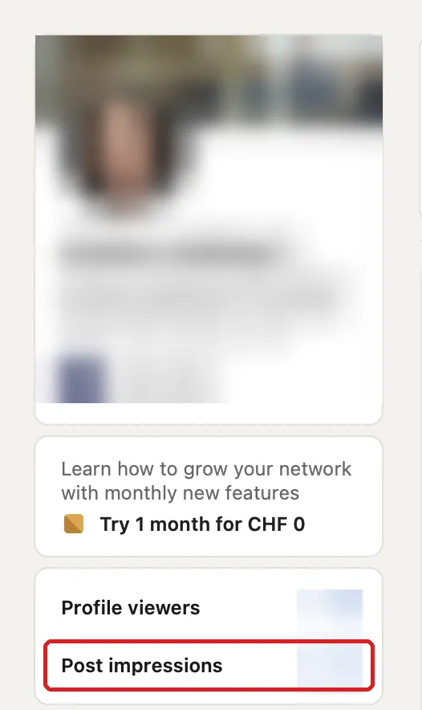

2. Under **Most recent post performance**, choose **Show all posts**.

   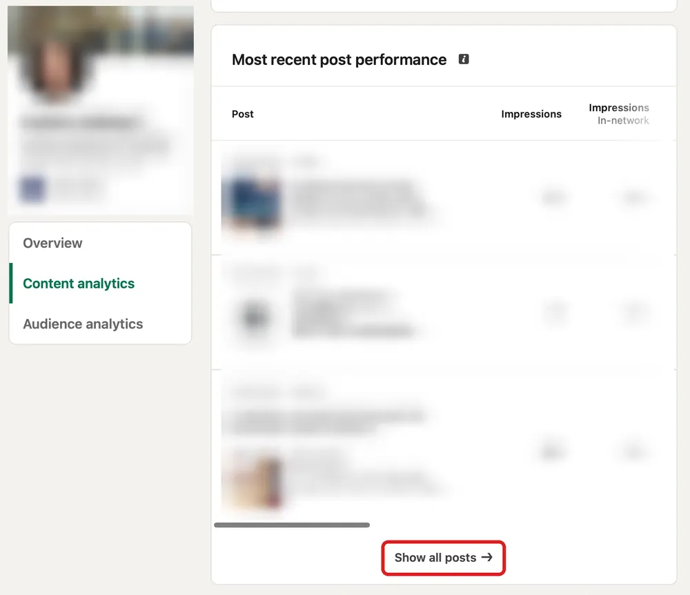

3. At the bottom of the page, choose **Load more** again and again until all your posts are loaded.

   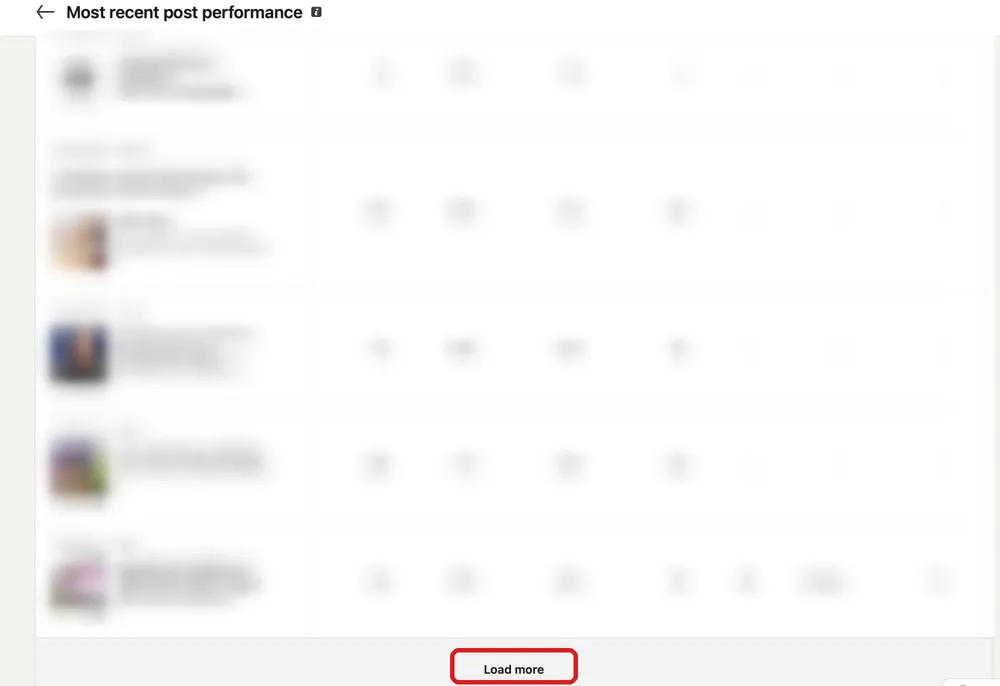

4. Choose **Export** at the top of the page.

   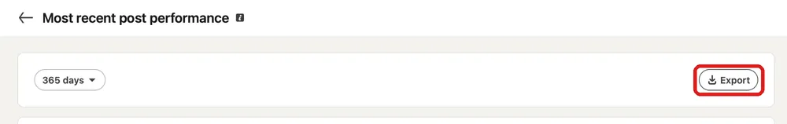

Then open Post Pulse and import the downloaded `.xlsx` file. Every later export is merged into your history, so posts and metrics accumulate over time. Personal details in the screenshots are blurred.

## How your data is protected
- **Nothing is uploaded.** The file is parsed in a Web Worker in your browser and stored in IndexedDB on your device.
- **No other site is contacted.** The Content Security Policy (`src/security/csp.ts`, mirrored in `netlify.toml`) allows only the app's own origin. Every end-to-end test fails on the first request to another origin.
- **No tracking.** No analytics, telemetry, error reporting, external fonts or CDNs.
- **Spreadsheet content is treated as untrusted text** and never rendered as HTML.
- **You stay in control.** Settings → Your data: download a backup, restore it, or delete everything.
- **Works offline** after the first visit, and can be installed as an app.

## What's in this repo
| Path | What it is |
|---|---|
| `src/` | The app itself: reading the export, storing it in the browser, the analysis, the "What stands out" insights, the share carousel and every screen |
| `tests/` | Automated tests outside `src/`: end-to-end flows in a real browser (`e2e/`), unit tests and helpers that build test posts |
| `fixtures/synthetic/` | Made-up LinkedIn exports the tests run against, each with its expected results |
| `docs/` | The specification (`SPEC.md`, the single source of truth) and the screenshots in this README |
| `public/` | Files served as they are: app icons and the images of the export how-to |
| `scripts/` | Helpers that generate the test exports and the icons, and check a deployed site's security headers |
| `.github/workflows/` | The checks GitHub runs on every push and pull request |
| `CLAUDE.md` | Working agreement for Claude Code, the AI assistant that builds this app with the owner |
| `netlify.toml` | Hosting: build command and security headers |
| `package.json` | Dependencies and the `npm run` commands below |
| Other config files | TypeScript, Vite, Vitest, Playwright, ESLint, Prettier and Lighthouse settings |

## Local development
Requires Node 24 (see `.nvmrc`).

```bash
npm install
npm run dev
```

| Command | What it does |
|---|---|
| `npm run dev` | Start the dev server |
| `npm run build` | Typecheck and build to `dist/` |
| `npm run preview` | Serve the production build on port 4173 |
| `npm test` | Unit and component tests |
| `npm run test:coverage` | Unit tests with coverage thresholds |
| `npm run test:e2e` | Playwright end-to-end tests (builds first) |
| `npm run test:private` | Tests against your own exports in `docs/data/` |
| `npm run lint` / `npm run format` | ESLint / Prettier |
| `npm run size` | Check the bundle size budget |
| `npm run lighthouse` | Lighthouse CI on the production build (needs Chrome; set `CHROME_PATH` if it isn't found) |
| `npm run icons` | Redraw the app icons in `public/icons/` |

### Testing with your own export
Put LinkedIn exports in `docs/data/`. The folder is gitignored, so they are never committed. Tests against them, with their expected values, go in `docs/data/tests/` (also gitignored, SPEC §11.4), because the values describe a real profile. `npm run test:private` runs them; without them it runs nothing.

## Deployment
Post Pulse is a static site and runs on Netlify (SPEC §10.4). `netlify.toml` defines the build and the security headers. The live example is built from a separate repository; this repository has no Netlify connection.

To host your own copy: fork this repository, then in the Netlify dashboard choose **Add new site → Import an existing project → GitHub** and pick your fork. The build settings come from `netlify.toml`. After that, every successful deploy triggers `.github/workflows/deploy-preview.yml`, which checks the deployed headers (TC-S07). You can also run the check by hand:

```bash
node scripts/check-deploy-headers.ts https://your-site.netlify.app
```

CI (GitHub Actions) runs typecheck, lint, format, unit tests with coverage, build, bundle size, end-to-end tests (including axe accessibility checks in light and dark) and Lighthouse on every pull request. `main` only takes green CI.

## Licence
[GNU Affero General Public License v3.0 or later](LICENSE). You may use, change and share Post Pulse; if you run a changed version for others, for example as a website, you must publish your changes under the same licence.
